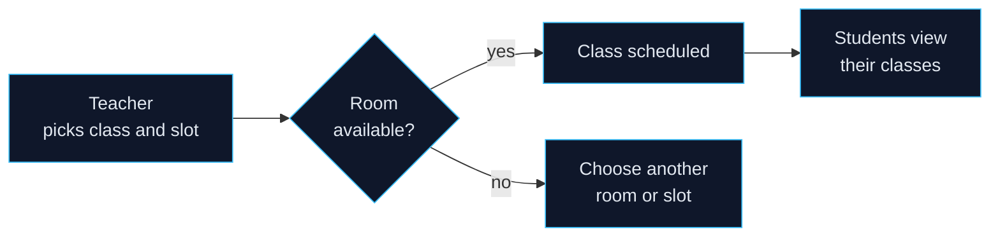

<!-- ═══════════════════════════════════════════════════════════════
     Profile README for github.com/AnshuSAHA176
     This file only shows on your profile if the repo is named exactly
     AnshuSAHA176/AnshuSAHA176 and is public.
     ═══════════════════════════════════════════════════════════════ -->

<a id="readme-top"></a>

<div align="center">


<a href="https://github.com/AnshuSAHA176">
  
</a>

<sub>Not an expert at everything yet. Just consistently getting better.</sub>

<br><br>

<a href="https://github.com/AnshuSAHA176"></a>
<a href="https://www.linkedin.com/in/anshu-saha-161539431/"></a>
<a href="mailto:anshusahaa62@gmail.com"></a>


<br><br>

<a href="#about"><kbd>about</kbd></a> &nbsp;
<a href="#focus"><kbd>in the lab</kbd></a> &nbsp;
<a href="#stack"><kbd>stack</kbd></a> &nbsp;
<a href="#projects"><kbd>projects</kbd></a> &nbsp;
<a href="#consistency"><kbd>consistency</kbd></a> &nbsp;
<a href="#connect"><kbd>connect</kbd></a>

</div>

<br>

<a id="about"></a>

## 01 / About

```bash
anshu@github:~$ whoami
anshu saha · BCA student · aspiring software engineer

anshu@github:~$ cat goal.txt
Become a top 1% problem solver and software engineer.

anshu@github:~$ status
learning   : DSA in Java, backend and database fundamentals
building   : full-stack projects with React and Node.js
exploring  : open-source contribution
next up    : a first meaningful open-source contribution
```

I'm a BCA student who likes turning ideas into software that actually runs. My time goes into two tracks: building full-stack projects with the MERN stack, and sharpening my problem-solving by practicing DSA in Java.

I'm not trying to look like I know everything. I'm trying to get better in a way I can measure: stronger fundamentals (OOP, recursion, data structures), cleaner REST APIs, and a real understanding of how software is built beyond "it works on my machine." I'm also exploring open source to see how real codebases are maintained.

The long-term target is easy to say and hard to do: **become a top 1% problem solver and software engineer.** This profile is the paper trail.

<br>

<a id="focus"></a>

## 02 / In the Lab

<table>
<tr>
<td width="50%" valign="top">

<b><code>01</code> &nbsp;Problem Solving</b>
<p>Improving Java and DSA fundamentals through regular LeetCode practice, with recursion and clean object-oriented design as a constant thread.</p>

</td>
<td width="50%" valign="top">

<b><code>02</code> &nbsp;Full-Stack Building</b>
<p>Building projects with React and Node.js, taking each one from the UI through the API down to the database.</p>

</td>
</tr>
<tr>
<td width="50%" valign="top">

<b><code>03</code> &nbsp;Backend and Data</b>
<p>Strengthening REST API development and database fundamentals across MongoDB and SQL.</p>

</td>
<td width="50%" valign="top">

<b><code>04</code> &nbsp;Beyond the Code</b>
<p>Exploring open-source contribution and learning what software engineering involves beyond just writing code.</p>

</td>
</tr>
</table>

<br>

<a id="stack"></a>

## 03 / Stack

<table>
<tr>
<th align="left" width="22%">Layer</th>
<th align="left">What I work with</th>
</tr>
<tr>
<td><b>Languages</b></td>
<td>

<br>

</td>
</tr>
<tr>
<td><b>Frontend</b></td>
<td>

</td>
</tr>
<tr>
<td><b>Backend</b></td>
<td>

<br>

</td>
</tr>
<tr>
<td><b>Databases</b></td>
<td>

<br>

</td>
</tr>
<tr>
<td><b>CS and Problem Solving</b></td>
<td>


</td>
</tr>
<tr>
<td><b>Developer Tools</b></td>
<td>

</td>
</tr>
<tr>
<td><b>Deployment and Services</b></td>
<td>


</td>
</tr>
<tr>
<td><b>Design</b></td>
<td>

<br>


</td>
</tr>
</table>

<br>

<a id="projects"></a>

## 04 / Projects

### College Class Scheduling System

> A class management system where teachers schedule classes based on room availability, and students view their classes.



**What it does**
- Teachers schedule classes against room availability.
- Students view their classes in one place.

**Built with** &nbsp;
<!-- TODO: confirm this matches what the project actually uses, and edit the badges if not. -->


<!-- TODO: add the repo link here, for example:
<p align="right"><a href="https://github.com/AnshuSAHA176/REPO-NAME"><b>View repository →</b></a></p>
-->

<!-- Template for the next project. Copy, uncomment and fill in:

### Project name

> One-sentence description of what it does and who it is for.

**What it does**
- Point one
- Point two

**Built with** &nbsp;


<p align="right"><a href="https://github.com/AnshuSAHA176/REPO-NAME"><b>View repository →</b></a></p>
-->

<p align="right"><a href="https://github.com/AnshuSAHA176?tab=repositories"><b>All repositories →</b></a></p>

<br>

<a id="consistency"></a>

## 05 / Consistency

Showing up regularly matters more to me than any single streak. These cards are a rough record of that.

<div align="center">


</div>

<!-- Add this after sharing your LeetCode username (swap in the real one):
<div align="center">

</div>
-->

<br>

<a id="connect"></a>

## 06 / Connect

I'm happy to talk about DSA and problem-solving, MERN projects, or getting started with open source. If you're working on something beginner-friendly and could use another pair of hands, I'd like to hear about it.

<div align="center">

<a href="mailto:anshusahaa62@gmail.com"></a>
<a href="https://www.linkedin.com/in/anshu-saha-161539431/"></a>

<br><br>

<code>Building. Learning. Improving.</code>

<br><br>

<a href="#readme-top">↑ Back to top</a>


</div>
