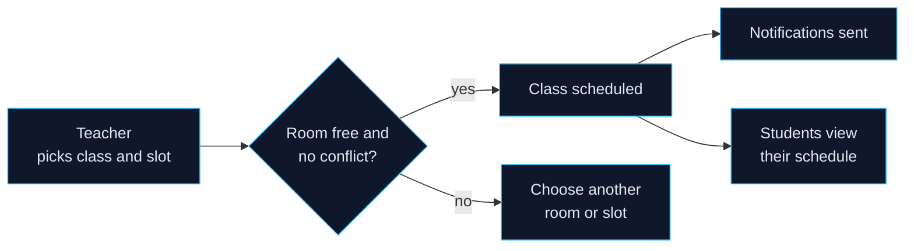

<!-- ═══════════════════════════════════════════════════════════════
     Profile README for github.com/ErMrinnmoySarkar
     This file only shows on your profile if the repo is named exactly
     ErMrinnmoySarkar/ErMrinnmoySarkar and is public.
     Live stats + fish animation come from .github/workflows/profile-assets.yml
     ═══════════════════════════════════════════════════════════════ -->

<a id="readme-top"></a>

<div align="center">


<a href="https://github.com/ErMrinnmoySarkar">
  
</a>

<sub>Not an expert at everything yet. Just consistently getting better.</sub>

<br><br>

<a href="https://github.com/ErMrinnmoySarkar"></a>
<a href="https://www.linkedin.com/in/mrinmoy-sarkar-5732b5361/"></a>
<a href="mailto:learnermrinmoy@gmail.com"></a>


<br><br>

<a href="#about"><kbd>about</kbd></a> &nbsp;
<a href="#focus"><kbd>in the lab</kbd></a> &nbsp;
<a href="#stack"><kbd>stack</kbd></a> &nbsp;
<a href="#projects"><kbd>projects</kbd></a> &nbsp;
<a href="#consistency"><kbd>consistency</kbd></a> &nbsp;
<a href="#connect"><kbd>connect</kbd></a>

</div>

<br>

<a id="about"></a>

## 01 / About

```bash
mrinmoy@github:~$ whoami
mrinmoy sarkar · BCA student · aspiring software engineer

mrinmoy@github:~$ cat goal.txt
Become a top 1% problem solver and software engineer.

mrinmoy@github:~$ status
learning   : Java, DSA and software engineering fundamentals
building   : full-stack applications with React and Node.js
exploring  : open source and real-world engineering
```

I'm a BCA student who likes turning ideas into software that actually runs. My time goes into two tracks: building full-stack projects with the MERN stack, and sharpening my problem-solving by practicing DSA in Java on LeetCode.

I'm not trying to look like I know everything. I'm trying to get better in a way I can measure: stronger fundamentals (OOP, recursion, data structures), cleaner REST APIs, sounder database design, and a real understanding of how software is built beyond "it works on my machine." I'm also exploring open source to see how real codebases are maintained.

The long-term target is easy to say and hard to do: **become a top 1% problem solver and software engineer.** This profile is the paper trail.

<br>

<a id="focus"></a>

## 02 / In the Lab

<table>
<tr>
<td width="50%" valign="top">

<b><code>01</code> &nbsp;Problem Solving</b>
<p>Improving Java and DSA fundamentals through regular LeetCode practice, with recursion and clean object-oriented design as a constant thread.</p>

</td>
<td width="50%" valign="top">

<b><code>02</code> &nbsp;Full-Stack Building</b>
<p>Building projects with React and Node.js, taking each one from the UI through the API down to the database.</p>

</td>
</tr>
<tr>
<td width="50%" valign="top">

<b><code>03</code> &nbsp;Backend and Data</b>
<p>Strengthening REST API development and database design across MongoDB and SQL.</p>

</td>
<td width="50%" valign="top">

<b><code>04</code> &nbsp;Beyond the Code</b>
<p>Exploring open-source contribution and learning what software engineering involves beyond just writing code.</p>

</td>
</tr>
</table>

<br>

<a id="stack"></a>

## 03 / Stack

<table>
<tr>
<th align="left" width="22%">Layer</th>
<th align="left">What I work with</th>
</tr>
<tr>
<td><b>Languages</b></td>
<td>

<br>

</td>
</tr>
<tr>
<td><b>Frontend</b></td>
<td>

</td>
</tr>
<tr>
<td><b>Backend</b></td>
<td>

<br>

</td>
</tr>
<tr>
<td><b>Databases</b></td>
<td>

<br>

</td>
</tr>
<tr>
<td><b>CS and Problem Solving</b></td>
<td>


</td>
</tr>
<tr>
<td><b>Developer Tools</b></td>
<td>

</td>
</tr>
<tr>
<td><b>Deployment and Services</b></td>
<td>


</td>
</tr>
<tr>
<td><b>Design</b></td>
<td>

<br>


</td>
</tr>
</table>

<br>

<a id="projects"></a>

## 04 / Projects

### College Class Scheduling System

> A system for managing college class scheduling and room availability.



**What it does**
- Teachers schedule classes through a dedicated teacher workflow.
- Room availability checks and conflict detection before a class is confirmed.
- Students view their schedule.
- Notifications for schedule changes.
- Built around REST API integration between the interface and the backend.

**Built with** &nbsp;
<!-- TODO: confirm this matches what the project actually uses, and edit the badges if not. -->


<!-- TODO: add the repo link here when you want it public, for example:
<p align="right"><a href="https://github.com/ErMrinnmoySarkar/REPO-NAME"><b>View repository →</b></a></p>
-->

<br>

<table>
<tr>
<td width="33%" valign="top">

<b>Personal Portfolio</b>
<p>My personal site showcasing projects, technical skills, and my developer journey.</p>

</td>
<td width="33%" valign="top">

<b>IndioTravlo</b> &nbsp;<sub><code>concept</code></sub>
<p>A travel application concept.</p>

</td>
<td width="33%" valign="top">

<b>Hackathon Calendar</b> &nbsp;<sub><code>idea</code></sub>
<p>A platform idea for finding and tracking upcoming hackathons.</p>

</td>
</tr>
</table>

<!-- Add repository or live links to the cards above only once they exist. -->

<p align="right"><a href="https://github.com/ErMrinnmoySarkar?tab=repositories"><b>All repositories →</b></a></p>

<br>

<a id="consistency"></a>

## 05 / Consistency

Consistency is not about maintaining a perfect streak. It's about returning to the work, solving problems, and making progress over time.

<div align="center">

<!-- All four assets below are generated from my own GitHub data by
     .github/workflows/profile-assets.yml and served from the "output" branch.
     They stay broken until that workflow has run once. -->


<br><br>


<br><br>


</div>

<br>

<a id="connect"></a>

## 06 / Connect

I'm happy to talk about DSA and problem-solving, MERN projects, or getting started with open source. If you're working on something beginner-friendly and could use another pair of hands, I'd like to hear about it.

<div align="center">

<a href="mailto:learnermrinmoy@gmail.com"></a>
<a href="https://www.linkedin.com/in/mrinmoy-sarkar-5732b5361/"></a>
<a href="https://github.com/ErMrinnmoySarkar"></a>

<br><br>

<code>Building. Learning. Improving.</code>

<br><br>

<a href="#readme-top">↑ Back to top</a>


</div>
